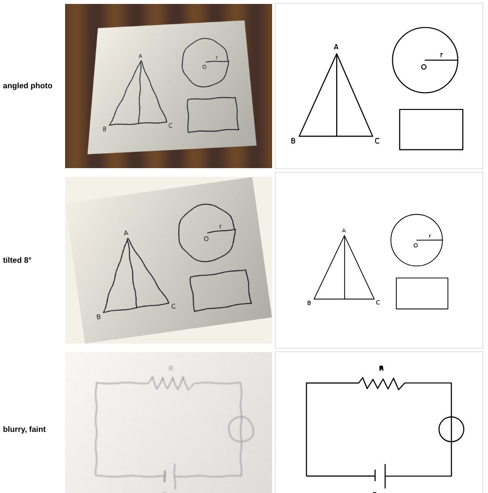
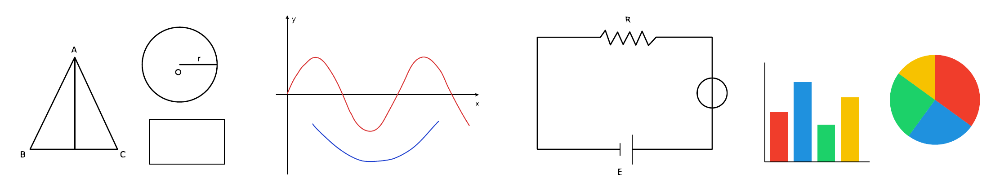

<p align="center"></p>

# TIS Diagram Pro ✏️ → 📐

**হাতে আঁকা বা স্ক্যান করা ডায়াগ্রামকে পরিষ্কার, স্ট্যান্ডার্ড Adobe Illustrator ভেক্টরে (.ai) রূপান্তর।**
Turn hand-drawn or scanned school diagrams into clean, editable Adobe Illustrator vectors.

গণিত, জ্যামিতি, গ্রাফ, পদার্থবিজ্ঞান, রসায়ন, সার্কিট, ICT, বার চার্ট, পাই চার্ট — ছবি দিলেই কোনো প্রম্পট ছাড়া
নিজে থেকে আকৃতি চিনে সোজা ও সুন্দর করে আঁকে। **সম্পূর্ণ ফ্রি · কোনো লগইন লাগে না · সব কাজ আপনার ডিভাইসেই হয়।**



---

## ✨ যা যা করে

| | |
|---|---|
| 📷 **ক্যামেরা / গ্যালারি** | মোবাইলে সরাসরি ছবি তুলুন, অথবা ফাইল টেনে আনুন / Ctrl+V |
| 📐 **পার্সপেক্টিভ ঠিক করা** | টেবিলের উপর কোণ থেকে তোলা কাগজের ছবি খুঁজে সোজাসুজি স্ক্যানের মতো করে |
| ↻ **বাঁকা ছবি সোজা** | রেখার দিক মেপে কত ডিগ্রি বাঁকা তা বের করে সোজা করে |
| ✨ **ঝাপসা/হালকা লাইন** | ছায়া ও কাগজের দাগ বাদ দিয়ে হালকা পেন্সিলের লাইনও স্পষ্ট করে |
| 🔷 **আকৃতি চেনা** | রেখা, বৃত্ত, উপবৃত্ত, ত্রিভুজ, আয়তক্ষেত্র, বর্গ, বৃত্তচাপ, বক্ররেখা, তীর চিহ্ন, ড্যাশ লাইন |
| 📏 **স্ট্যান্ডার্ড করা** | প্রায়-সোজা রেখা ০°/৪৫°/৯০°-এ, প্রায়-লম্ব রেখা একদম লম্ব, কোণাগুলো ঠিক জায়গায় জোড়া, সব লাইনের পুরুত্ব সমান |
| 📊 **রঙিন চার্ট** | বার চার্ট, পাই চার্ট ও রঙিন কলমের দাগ আলাদা রঙে ভরাট আকৃতি হিসেবে |
| 🔤 **হাতের লেখা পড়া (ফ্রি, অফলাইন)** | A, B, x, y, 5cm… পড়ে আসল এডিটযোগ্য টেক্সট বানায়; লেবেলের মাপ সমান করে |
| ✏️ **এক ট্যাপে সংশোধন** | যেকোনো লেখায় ট্যাপ করে টাইপ করুন — `H_2O` → H₂O, `x^2` → x² |
| 🤖 **Claude AI (ঐচ্ছিক)** | claude.ai-তে খুললে খুব অস্পষ্ট লেখা Claude দিয়ে পড়িয়ে নেওয়া যায় (দরকার নেই) |
| ⬇️ **ডাউনলোড** | **.AI** (Illustrator), **.SVG**, **.PDF**, **.PNG** — প্রতিটি রেখা/বৃত্ত আলাদা অবজেক্ট |



## 🚀 কীভাবে ব্যবহার করবেন

### ১. ব্রাউজারে (ল্যাপটপ / মোবাইল)
`index.html` ফাইলটি ডাউনলোড করে যেকোনো ব্রাউজারে খুলুন — ইনস্টল লাগে না, ইন্টারনেট ছাড়াও চলে।
GitHub Pages চালু থাকলে সরাসরি লিংক থেকেও চালানো যাবে।

### ২. Android অ্যাপ (APK)
রিপোজিটরির **[Releases](../../releases)** পাতা থেকে `TIS-Diagram-Pro.apk` ডাউনলোড করে ফোনে ইনস্টল করুন।
প্রতিবার কোড আপডেট হলে GitHub Actions নিজে থেকে নতুন APK বানিয়ে দেয়।
নিজে বানাতে চাইলে: [android/README_BANGLA.md](android/README_BANGLA.md)

### ৩. ধাপগুলো
1. **ছবি দিন** — ক্যামেরা, গ্যালারি, ড্র্যাগ-ড্রপ বা পেস্ট
2. **নিজে থেকে আঁকা হয়** — "পাশাপাশি" / "মিলিয়ে দেখুন" ভিউতে মূল ছবির সাথে মিলিয়ে নিন
3. প্রয়োজনে কোনো অংশে ক্লিক করে মুছুন, রং/পুরুত্ব বদলান, লেখা ঠিক করুন
4. **.AI ডাউনলোড** করে Illustrator-এ খুলুন

## 🧠 কীভাবে কাজ করে

```
ছবি ─► কাগজ খোঁজা + পার্সপেক্টিভ ঠিক ─► আলো সমান করা ─► কালি আলাদা করা (top-hat + hysteresis)
    ─► রঙ অনুযায়ী লেয়ার ─► কঙ্কাল (skeleton) গ্রাফ ─► কোণা খোঁজা
    ─► প্রতিটি অংশ: রেখা / বৃত্তচাপ / বেজিয়ার বক্ররেখা ─► বৃত্ত, ত্রিভুজ, আয়তক্ষেত্র, তীর চেনা
    ─► কোণ স্ন্যাপ, জোড়া লাগানো, লম্ব করা ─► বাঁকা হলে সোজা করে আবার ─► লেখা পড়া (OCR)
    ─► SVG / PDF / .AI (PDF-compatible) এক্সপোর্ট
```

| ফাইল | কাজ |
|---|---|
| `src/engine.js` | ছবি → ভেক্টর ইঞ্জিন (কোনো লাইব্রেরি ছাড়া, খাঁটি JavaScript) |
| `src/exporter.js` | SVG, PDF ও Illustrator .ai এক্সপোর্ট (টেক্সট, সাবস্ক্রিপ্ট, গ্রিক/গণিত চিহ্নসহ) |
| `src/ocr.js` | অফলাইন হাতের লেখা পড়া — ডিভাইসের ফন্ট থেকে বানানো অক্ষরের সাথে কঙ্কাল মিলিয়ে |
| `src/app.html` | ইউজার ইন্টারফেস (বাংলা) |
| `build.py` | সব মিলিয়ে একটি ফাইল `index.html` বানায় → `python3 build.py` |
| `android/` | Android WebView অ্যাপ (ক্যামেরা, Downloads-এ সেভ) |
| `tests/images/` | টেস্টের নমুনা ছবি (জ্যামিতি, গ্রাফ, সার্কিট, চার্ট, বাঁকা, ঝাপসা, হাতের লেখা) |

## ⚠️ সীমাবদ্ধতা
- কোনো সফটওয়্যারই সব ছবিতে ১০০% নির্ভুল হতে পারে না — খুব অগোছালো ছবিতে কিছু অংশ হাতে ঠিক করতে হতে পারে (এডিট টুল ও "আগের অবস্থা" বাটন আছে)।
- অফলাইন লেখা-পড়া ছোট লেবেলের জন্য; জোড়া লাগানো (টানা) হাতের লেখা ও ছোট-বড় হাতের কিছু অক্ষরে ভুল হতে পারে।
- বাংলা লেখা টেক্সটে বদলায় না, পরিষ্কার আঁকা আকৃতি হিসেবে থাকে।
- .ai ফাইলটি PDF-compatible ফরম্যাটে — Illustrator সরাসরি খুলে এডিট করতে পারে।

## 👨‍🏫 ডেভেলপার

<p align="center"></p>
<h3 align="center">তারিকুল ইসলাম (সুমন)</h3>
<p align="center"><b>────── MSc Mathematics ──────</b></p>

<p align="center">
  <a href="https://www.youtube.com/@tis.academy24"></a>
  <a href="https://www.facebook.com/tariqul.islam.422531/"></a>
  <a href="https://wa.me/8801755489719"></a>
  <a href="https://github.com/tariqulislam4015"></a>
</p>

## 📄 লাইসেন্স
[MIT](LICENSE) © Tariqul Islam
